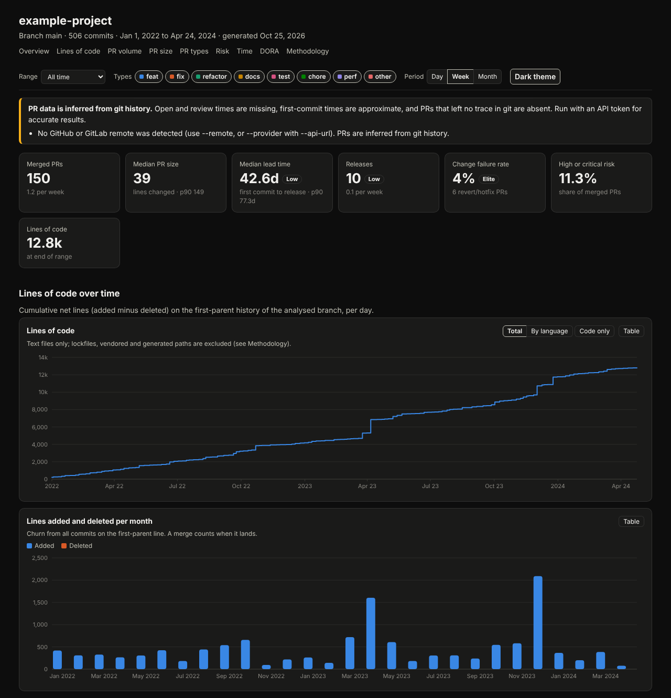
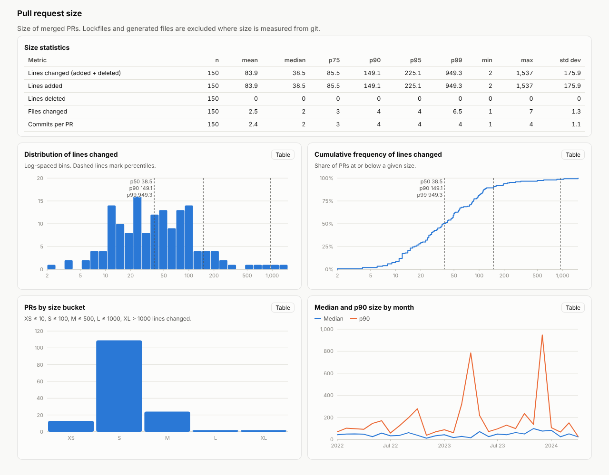

= repo-stats

Generate a self-contained HTML dashboard of code statistics for any git repository.

* Lines of code over time, in total and by language, plus monthly churn.
* Pull request (or merge request) volume per day, week and month.
* PR size: lines, files and commits.
* PR type, read from Conventional Commit titles.
* A transparent risk score for each PR.
* Time per PR: coding, pickup, review, open to merge, lead time and merge to release.
* Review cycles per PR, and how many PRs were merged with no review (API data).
* DORA metrics: deployment frequency, lead time for changes, change failure rate and time to restore.

Every metric shows count, mean, median, p75, p90, p95, p99, min, max and standard deviation.
Where a distribution matters, the dashboard adds a histogram and a cumulative frequency chart.

.Overview in the default dark theme (synthetic example repository)

.PR size section in the light theme

The tool is one Python file plus one HTML template. It needs Python 3.8 or newer and git.
For exact PR data it also uses the GitHub CLI (`gh`) or the GitLab CLI (`glab`), with the login you already have.
The output is a single HTML file. It works offline, and you can mail it, attach it or host it anywhere.

== Quick start

[source,sh]
----
# from a clone of this repository
python3 repo-stats/repo_stats.py /path/to/your/repo --serve     # builds the dashboard and opens it

# exact PR data: log in to gh or glab once (skip this if you already use them)
gh auth login              # or: glab auth login
python3 repo-stats/repo_stats.py /path/to/repo -o stats.html

# only PRs from January to July 2025, or from the last year (see "Time window")
python3 repo-stats/repo_stats.py /path/to/repo --since 2025-01 --until 2025-07
python3 repo-stats/repo_stats.py /path/to/repo --since 1y
----

No tokens or environment variables are needed: repo-stats asks `gh` or `glab` for the data, and they use their own login.
Run `repo_stats.py --help` for every flag.

== Where the data comes from

Git has no record of pull requests. The tool has two sources and says on the dashboard which one it used.

API (recommended)::
When the remote is on `github.com` or `gitlab.com` and `gh` or `glab` is installed and logged in, the tool reads PRs from the GitHub GraphQL API or the GitLab REST API through `gh api` or `glab api`.
Open, ready-for-review, first review and merge times are then exact.
For GitHub Enterprise or self-managed GitLab, pass `--provider` and `--hostname HOST`.
If the CLI is missing or not logged in, the tool says how to fix it and uses git instead (or exits, with `--source api`).

Git only (fallback)::
Without the API, PRs are inferred from history.
A PR is a merge commit on the branch, or a squash commit whose subject ends in `(#123)` or whose body names a merge request.
GitHub, GitLab and Bitbucket message formats are recognised.
Open and review times do not exist in git, so those metrics are empty.
Coding and review time fall back to labelled proxies: first to last branch commit, and last commit to merge.
Repositories that rebase-merge with no PR number in the message show few or no PRs. Use the API, or pass `--commits-as-prs`.

Lines of code, churn and release data always come from the local clone.
A shallow clone gives incomplete history, and the dashboard warns about it. Run `git fetch --unshallow` first.

== Time window

`--since` and `--until` limit the PRs (by merge time, or open time if unmerged) and the releases on the dashboard.
Lines of code over time always use the full history.
Both options are optional, and you can use either one alone.

[cols="1,2,2"]
|===
| Value | Meaning for `--since` | Meaning for `--until`

| `YYYY-MM-DD`, e.g. `2025-01-15` | from the start of that day | to the end of that day
| `YYYY-MM`, e.g. `2025-07` | from the first day of that month | to the end of that month
| `YYYY`, e.g. `2025` | from 1 January | to the end of 31 December
| `Nd`, `Nw`, `Nm`, `Ny`, e.g. `90d`, `6w`, `6m`, `1y` | from N days, weeks, months or years ago | up to N days, weeks, months or years ago
|===

* Dates are in UTC. Write them in full, with leading zeros: `2025-01-05`, not `2025-1-5`.
* `N` is a whole number of at least 1. Months and years are calendar months back from now: one month before 31 March is 28 (or 29) February.
* `--since` must be before `--until`, otherwise the run stops with an error.

[source,sh]
----
--since 2025-01 --until 2025-07        # 1 January to 31 July 2025
--since 2025 --until 2025              # all of 2025
--since 2025-03-15 --until 2025-03-31  # second half of March 2025
--since 1y                             # the last 12 months
--since 90d                            # the last 90 days
--since 2y --until 1y                  # the year before last
----

== Logging in

repo-stats never reads, stores or sends a token. `gh` and `glab` find their own login, in this order: an environment variable (`GH_TOKEN`, `GITLAB_TOKEN`), then the login saved by `gh auth login` or `glab auth login` (in the OS keychain where there is one).

=== On your machine

Use the login you already have, or run `gh auth login` / `glab auth login` once. Nothing else is needed.
If neither CLI is installed or logged in, repo-stats prints a warning and uses local git history instead.

Those logins can write to your repositories, though repo-stats only ever reads (see <<read-only>>).
To run with a read-only token instead (a GitHub fine-grained token with read-only Contents and Pull requests, or a GitLab token with only `read_api`), give it to the CLI for one run, for example from a password manager, so it never appears in shell history:

[source,sh]
----
GH_TOKEN="$(op read op://Private/gh-readonly/token)" python3 repo-stats/repo_stats.py /path/to/repo
----

Do not load a read-only token with `gh auth login --with-token`: gh keeps one keychain entry per host and account, so it would replace your normal login.

=== GitHub Actions

`gh` is installed on GitHub-hosted runners. Give the step the job's own token, limited to read access:

[source,yaml]
----
permissions:
  contents: read
  pull-requests: read
jobs:
  stats:
    runs-on: ubuntu-latest
    steps:
      - uses: actions/checkout@v4
        with:
          fetch-depth: 0                          # full history and tags
      - uses: actions/checkout@v4
        with:
          repository: husam-e/scripts
          path: tools
      - run: python3 tools/repo-stats/repo_stats.py . -o repo-stats.html
        env:
          GH_TOKEN: ${{ github.token }}           # read by gh only; expires when the job ends
      - uses: actions/upload-artifact@v4
        with:
          name: repo-stats
          path: repo-stats.html
----

Set `GH_TOKEN` on this step only, so other steps never see it.
To analyse another private repository, use a GitHub App installation token (for example from `actions/create-github-app-token`), not a personal token.

=== GitLab CI

[source,yaml]
----
repo-stats:
  image: registry.gitlab.com/gitlab-org/cli:v1.124.0    # glab and git; pin a version
  variables:
    GIT_DEPTH: 0                                        # full history
    GLAB_ENABLE_CI_AUTOLOGIN: "true"                    # glab signs in with the job's CI_JOB_TOKEN
  script:
    - apk add --no-cache python3
    - git clone --depth 1 https://github.com/husam-e/scripts.git /tmp/tools
    - python3 /tmp/tools/repo-stats/repo_stats.py . -o repo-stats.html
  artifacts:
    paths: [repo-stats.html]
----

The job token expires when the job ends. It can list merge requests and read their comments, but not their commits.
repo-stats then takes first-commit times from local merge commits and says so on the dashboard; squash-merged MRs have no coding time.
For full data, add a project access token with only the `read_api` scope and a short expiry as a masked, protected CI/CD variable named `GITLAB_TOKEN`.
The job token is not strictly read-only (GitLab also lets it create releases and deployments), so prefer a `read_api` token where that matters.
On self-managed GitLab, a remote on the job's own server (`CI_SERVER_HOST`) is used without `--hostname`.

=== Scheduled or remote jobs

Give the token to the run only, from your secret store, and prefer short-lived, read-only tokens: a GitHub App installation token, or a fine-grained token with read-only Contents and Pull requests; on GitLab, a `read_api` project or group token with an expiry.

[source,sh]
----
# systemd: LoadCredential=gh-token:/etc/creds/gh-token, then in the service's script:
GH_TOKEN="$(cat "$CREDENTIALS_DIRECTORY/gh-token")" python3 repo_stats.py /srv/repo -o /srv/out/stats.html
# Jenkins: withCredentials([string(credentialsId: 'gh-read', variable: 'GH_TOKEN')]) { sh '...' }
# Kubernetes: mount the secret as an environment variable of the container
----

Avoid `gh auth login` and `glab auth login` on servers: with no keychain, they save the token in a plain-text file.

[[read-only]]
== Security

repo-stats only reads:

* API requests go through `gh api` and `glab api` and pass a fixed allowlist: GraphQL queries only (never a mutation) for GitHub, and `GET` on the merge request list, commits and notes endpoints for GitLab. Anything else is refused before a process starts.
* git is run only with read commands (`log`, `rev-parse`, `for-each-ref`, `symbolic-ref`, `remote get-url`).
* The tests enforce both rules.

Only a read-only token makes this a guarantee: with a `gh auth login` or `glab auth login` token, the rules protect against bugs, not against a modified copy of the script.

repo-stats never handles a credential:

* It never reads a token variable. `gh` and `glab` read their own.
* The API host is `github.com` or `gitlab.com` from the remote, or the `--hostname` you pass. It is never taken from any other remote, because `gh` and `glab` send environment tokens to whatever host they are given. A lookalike remote such as `github.evil.example` starts no CLI at all.
* The CLI always gets `--hostname` and runs from the system temp directory, never the analysed repository, so `glab` cannot pick up a host from the repository's remote. glab telemetry (which sends its own request with the credential) and the CLIs' request-logging debug switches are turned off for these calls.
* git runs without the credential variables (`GH_TOKEN`, `GITLAB_TOKEN`, `CI_JOB_TOKEN` and the like), so hooks or filters in the analysed repository cannot read them.
* No token is written to any output.

Other protections:

* `--serve` binds to 127.0.0.1, serves only the dashboard file, and rejects any request whose Host header is not `127.0.0.1` or `localhost` on the serving port.
* The dashboard carries a Content-Security-Policy that allows no network access, so it cannot send data anywhere even when opened from a mail attachment.
* Commit messages are read in a separate, NUL-delimited git call, so their text cannot change diff statistics.
* If a GitLab per-MR lookup fails, the review status and timings for that MR are left empty and the dashboard warns; they are never counted as "unreviewed".

What remains:

* Any program running as you can ask `gh` or `glab` for its token. Read-only, short-lived tokens limit what a leaked or misused token can do.
* A wrong `--hostname` is trusted: an environment token for that CLI goes to it.
* In CI, the token is readable by every process in the step that sets it.
* Analysing a repository you do not trust still runs git on it.

== Heuristics

The dashboard has a Methodology section that prints the rules it used. The defaults are:

Lines of code::
Net lines added minus deleted along the first-parent history of the branch, for text files.
Lockfiles, vendored, build output and minified files are excluded.
Use `--exclude REGEX` to add paths, or `--no-default-excludes` to count everything.

PR type::
The Conventional Commit type in the PR title.
If the title has none, the branch prefix is used (`feat/...`), then a label, then a keyword guess.
The dashboard shows how many types came from each source, so you can judge how reliable the type data is.

Risk score (0 to 100)::
Points add up:
+
* size: up to 40
* files changed: up to 15
* type: for example, feat 8, fix 6, docs 0
* breaking change: +15
* sensitive paths (migrations, auth, security, payments, infra, CI and container files): +10
* 50+ lines of source changed with no test file touched: +8
* merged with no review from someone other than the author (API only): +10
+
Levels are low (< 20), medium (< 40), high (< 60) and critical.
A rule that needs data the source lacks is skipped, never guessed.
The score is a triage signal, not a prediction.

Deployment::
A release tag matching `--tag-pattern`.
The default is any version number, semver or not, such as `v1`, `v1.2`, `1.2.3` or `2024.05.01`.
Pre-releases (`-rc`, `-alpha`, `-beta`, `-dev`, `-pre`, `-preview`, `-next`, `-canary`, `-SNAPSHOT`, `-nightly`, and PEP 440 `1.0.0a1` or `1.0.0b2`) are excluded.
Use `--deploy-source merges` to count every merge as a deployment.

Change failure::
A merged PR that is a revert (type `revert`, or a title starting with Revert, Reverts, Reverted or Reverting), or whose title, branch or labels match `--failure-pattern` (default: hotfix, rollback and emergency).
The rate is failures divided by merged PRs.

Time to restore::
For reverts that name the commit they undo: the time from the reverted change's merge to the revert's merge.

Review cycles (API only)::
One round of review on one version of the PR, by anyone but the author and bots, before the merge.
Approved on first look is 1 cycle; changes requested, a fix pushed and an approval is 2.
Several reviewers on the same version are one cycle, and a push nobody reviews before the merge adds none.
On GitHub, each review names the commit it was made against, so a review of a new commit (including after a force-push) starts a new cycle.
On GitLab, comments and approvals by others are reviews and "added N commits" system notes are pushes; a cycle is the reviews between two pushes. All of an MR's notes are read, up to 50 cycles.
The dashboard shows the statistics without unreviewed PRs, with them counted as 0, and the number of PRs merged with no review.
Git history has no reviews, so in git mode cycles are empty, never guessed.

Performance bands::
The Elite, High, Medium and Low bands use rounded thresholds from published DORA reports. Treat them as rough.

== Useful flags

[cols="1,3"]
|===
| `--branch REF` | Branch to analyse. The default is the remote's default branch.
| `--since / --until WHEN` | Limit the PR window: a UTC date, month or year (`2025-01-15`, `2025-01`, `2025`) or a duration back from now (`90d`, `6w`, `6m`, `1y`). See <<Time window>>.
| `--exclude-bots` | Drop PRs from bots (Dependabot, Renovate, `[bot]` accounts).
| `--no-titles` | Replace PR titles and scopes with numbers before sharing the file.
| `--json FILE`, `--csv FILE` | Export the raw data.
| `--all-bases` | Include PRs that target other branches.
| `--max-prs N` | Stop after N PRs. Useful on very large repositories.
| `--provider`, `--hostname HOST` | Use GitHub Enterprise or self-managed GitLab.
| `--source git` | Never call the API.
|===

The dashboard filters by date range, PR type and bots, and switches between day, week and month.
It opens in a dark theme and has a light theme toggle.
Every chart has a Table view with the numbers behind it.

== Tests

[source,sh]
----
cd repo-stats && python3 -m unittest discover -s tests -v
----

The tests build synthetic repositories and run the API code through fake `gh` and `glab` commands (`tests/fake_cli`) that answer from local mock servers. No test reaches the network or a real login.
The browser tests use Playwright with Chromium, and skip when either is missing.
